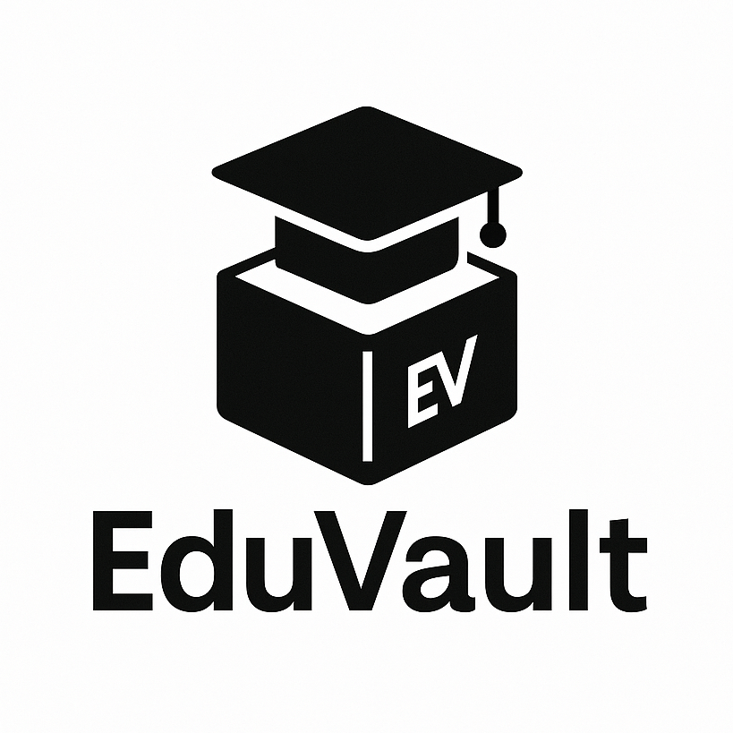
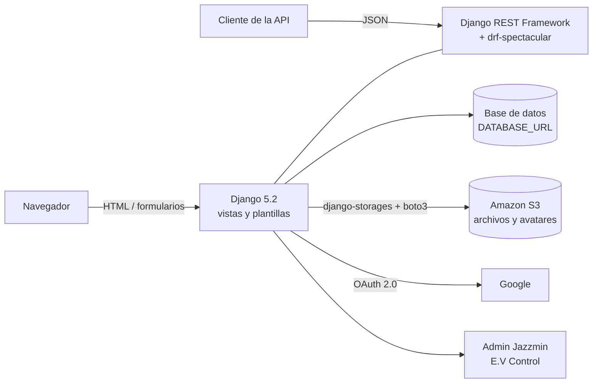

<div align="center">
  
  <h1>EduVault</h1>
  <p><b>Plataforma web para almacenar, organizar y compartir archivos académicos</b><br/>Pensada para estudiantes y docentes de UNIMINUTO</p>

  
  
  
  
  
  
  <a href="LICENSE"></a>
</div>

<details>
<summary><b>English summary</b></summary>

EduVault is a Django web platform where university students and teachers upload, classify and share academic files (PDF, Word, Excel, images and video). Each file belongs to a subject, can carry several tags and can be kept private or published to the rest of the community. Users sign in with a local account or with Google (django-allauth), manage their profile and avatar, and filter files by subject, tag, type, title and date. Files are stored in Amazon S3, and an admin panel built with Jazzmin lets staff manage subjects, tags, files and users.

The project also exposes a REST API (Django REST Framework) for files, subjects and tags, documented with OpenAPI through drf-spectacular (Swagger UI and ReDoc). It was built as an academic project at UNIMINUTO and is configured for deployment on Render with Gunicorn and WhiteNoise.

</details>

## Qué es

En la universidad los apuntes, talleres, guías y trabajos terminan repartidos entre correos, memorias USB y carpetas personales, y compartirlos con un compañero suele ser más difícil de lo que debería. EduVault centraliza esos archivos en una sola plataforma web: cada usuario sube sus documentos, los clasifica por materia y etiquetas, decide si son privados o públicos y puede consultar lo que otros miembros de la comunidad han publicado.

El sistema está construido con Django y sirve dos tipos de cliente: la interfaz web con plantillas para el uso diario y una API REST documentada para integraciones futuras. Los archivos se guardan en Amazon S3 y la base de datos se configura por `DATABASE_URL`, lo que permite desplegarlo en Render sin cambios de código.

## Funcionalidades

**Cuentas y acceso**

- Registro e inicio de sesión con cuenta local o con Google (OAuth 2.0 con PKCE), mediante `django-allauth` y plantillas propias.
- Perfil de usuario con avatar; el perfil se crea automáticamente al registrar un usuario (señales de Django).

**Gestión de archivos**

- Subida de archivos PDF, Word (`.docx`), Excel (`.xlsx`), imágenes (`.jpg`, `.png`) y video (`.mp4`, `.mkv`, `.avi`), con validación de extensión y un límite de 100 MB por archivo.
- Clasificación por materia, tipo de archivo y múltiples etiquetas.
- Archivos privados o públicos: en "Mis archivos" cada usuario ve los suyos junto con los públicos de los demás; la sección "Archivos públicos" muestra solo lo compartido.
- Filtros por materia, etiquetas, tipo, título y fecha (más reciente, más antiguo, últimos 7 o 30 días) con `django-filter`.
- Vista previa de imágenes y videos, apertura del archivo en otra pestaña y descarga directa.
- Al eliminar un registro también se borra el archivo del bucket de S3.

**Administración**

- Panel administrativo "E.V Control" basado en el admin de Django con el tema Jazzmin: gestión de archivos, materias, etiquetas, perfiles, usuarios, grupos y la aplicación social de Google.

**API REST**

- Endpoints CRUD para archivos, materias y etiquetas con Django REST Framework.
- Permisos por objeto: solo el autor puede editar o borrar su archivo, y los archivos públicos solo los puede borrar un superusuario.
- Esquema OpenAPI generado con `drf-spectacular`, con Swagger UI y ReDoc.

| Ruta | Descripción |
| --- | --- |
| `/api/archivos/` | Archivos del usuario autenticado (todos, si es superusuario) |
| `/api/materias/` | Materias |
| `/api/etiquetas/` | Etiquetas |
| `/schema/` | Esquema OpenAPI |
| `/swagger/` | Documentación interactiva (Swagger UI) |
| `/docs/` | Documentación en ReDoc |

La documentación de la API requiere una sesión iniciada (`SERVE_PERMISSIONS = IsAuthenticated`).

**Herramienta adicional**

- Módulo "Matrices": resuelve sistemas de ecuaciones lineales por el método de Gauss-Jordan, con matriz aleatoria o ingresada a mano, y muestra cada paso del algoritmo.

## Arquitectura



- **Un solo proyecto Django** (`Backend/`) con una aplicación (`EduVault/`) que contiene modelos, vistas web, viewsets de la API, filtros y señales.
- **Archivos fuera del servidor**: el almacenamiento por defecto es `S3Storage`, así que los archivos subidos y los avatares no dependen del disco efímero de Render. Los estáticos se sirven con WhiteNoise.
- **Configuración por entorno** con `python-decouple` y `dj-database-url`: la clave secreta, la base de datos, las credenciales de AWS y las de Google se leen de variables de entorno.
- **Autenticación combinada**: backend de modelos de Django más el de `allauth`, con el proveedor de Google configurado en `settings.py`.
- **Seguridad en producción**: cookies de sesión y CSRF seguras, HSTS de un año y orígenes de confianza para `*.onrender.com`.

## Stack tecnológico

| Capa | Tecnología |
| --- | --- |
| Lenguaje | Python 3 |
| Framework web | Django 5.2.1 |
| API | Django REST Framework 3.16.0, drf-spectacular 0.28.0, django-filter 25.1 |
| Autenticación | django-allauth 65.7.0 (cuentas locales y Google) |
| Panel administrativo | django-jazzmin 3.0.1 |
| Almacenamiento de archivos | Amazon S3 con django-storages 1.14.6 y boto3 |
| Base de datos | Cualquier motor soportado por `dj-database-url` (dependencias para PostgreSQL y MySQL incluidas) |
| Frontend | Plantillas de Django, Bootstrap, Font Awesome |
| Servidor | Gunicorn 23 y WhiteNoise 6.9 |
| Otros | NumPy (Gauss-Jordan), Pillow (imágenes) |

## Puesta en marcha

**Requisitos:** Python 3.10 o superior, una base de datos PostgreSQL o MySQL y un bucket de Amazon S3. Para el inicio de sesión con Google se necesita además un cliente OAuth creado en Google Cloud Console.

```bash
git clone https://github.com/Joan-Mora/EduVault.git
cd EduVault

python -m venv venv
# Windows: venv\Scripts\activate   |   Linux/macOS: source venv/bin/activate
pip install -r requirements.txt

cp .env.example .env   # completa los valores
python manage.py migrate
python manage.py createsuperuser
python manage.py runserver
```

### Variables de entorno

Todas se leen desde `.env` (ver [`.env.example`](.env.example)):

| Variable | Uso |
| --- | --- |
| `SECRET_KEY` | Clave secreta de Django |
| `DATABASE_URL` | Cadena de conexión a la base de datos |
| `AWS_ACCESS_KEY_ID`, `AWS_SECRET_ACCESS_KEY` | Credenciales de AWS para S3 |
| `AWS_STORAGE_BUCKET_NAME`, `AWS_S3_REGION_NAME` | Bucket y región donde se guardan los archivos |
| `GOOGLE_CLIENT_ID`, `GOOGLE_CLIENT_SECRET` | Cliente OAuth de Google para `django-allauth` |

> **Ejecución local:** `settings.py` está configurado para producción (`DEBUG = False`, `ALLOWED_HOSTS = ['.onrender.com']`, cookies solo por HTTPS). Para probar en `localhost` hay que agregar `localhost` y `127.0.0.1` a `ALLOWED_HOSTS`, activar `DEBUG` y desactivar `CSRF_COOKIE_SECURE` y `SESSION_COOKIE_SECURE` mientras se trabaja sin HTTPS.

## Despliegue

El proyecto está preparado para un servicio web de Render: `ALLOWED_HOSTS` y `CSRF_TRUSTED_ORIGINS` aceptan `*.onrender.com`, Gunicorn sirve la aplicación WSGI (`Backend.wsgi`) y WhiteNoise entrega los estáticos. El repositorio no incluye `render.yaml` ni `Procfile`; una configuración equivalente es:

```bash
# Build
pip install -r requirements.txt && python manage.py collectstatic --noinput && python manage.py migrate
# Start
gunicorn Backend.wsgi:application
```

Las variables de entorno de la tabla anterior se definen en el panel del servicio.

## Estructura del repositorio

```
EduVault/
├── Backend/              # Proyecto Django: settings, urls, wsgi/asgi
├── EduVault/             # Aplicación principal
│   ├── models.py         # Profile, Materia, Etiqueta, Archivo
│   ├── views.py          # Vistas web, viewsets de la API y Gauss-Jordan
│   ├── serializers.py    # Serializadores de DRF
│   ├── filters.py        # Filtros de archivos (django-filter)
│   ├── signals.py        # Creación de perfiles y borrado de archivos en S3
│   ├── migrations/
│   └── templates/        # Plantillas propias y de allauth
├── static/               # CSS e imágenes del proyecto (logo, íconos)
├── staticfiles/          # Estáticos recopilados (collectstatic)
├── fixtures/             # Materias y etiquetas iniciales (loaddata)
├── manage.py
└── requirements.txt
```

## Autoría

<table>
  <tr>
    <td align="center"><a href="https://github.com/Joan-Mora"><br/><b>Darwin Joan Aveiga Mora</b></a><br/><sub>Desarrollo full stack: modelos, API REST, interfaz, autenticación y despliegue</sub></td>
    <td align="center"><a href="https://github.com/MrRoar154"><br/><b>Julian Esteban Chavez Zamora</b></a><br/><sub>Equipo de desarrollo</sub></td>
  </tr>
</table>

Equipo de desarrollo: Darwin Joan Aveiga Mora, Julian Esteban Chavez Zamora, Santiago Romero Carranza, Jonnathan Steven Rodriguez y Luis Eduardo Perez.

Proyecto académico desarrollado en UNIMINUTO (Corporación Universitaria Minuto de Dios).

## Licencia

Copyright © 2025-2026 Darwin Joan Aveiga Mora y el equipo de desarrollo de EduVault. **Todos los derechos reservados.**

Este repositorio es público para que el código pueda consultarse como parte de mi portafolio. Eso no concede permiso para copiarlo, reutilizarlo, modificarlo, distribuirlo ni presentarlo como trabajo propio. Los términos completos están en [`LICENSE`](LICENSE). Para cualquier uso, escribe a [darwin@abacore.co](mailto:darwin@abacore.co).

<div align="center">
<sub>Hecho por <a href="https://github.com/Joan-Mora">Darwin Aveiga</a> · <a href="https://abacore.co">Abacore S.A.S.</a></sub>
</div>
